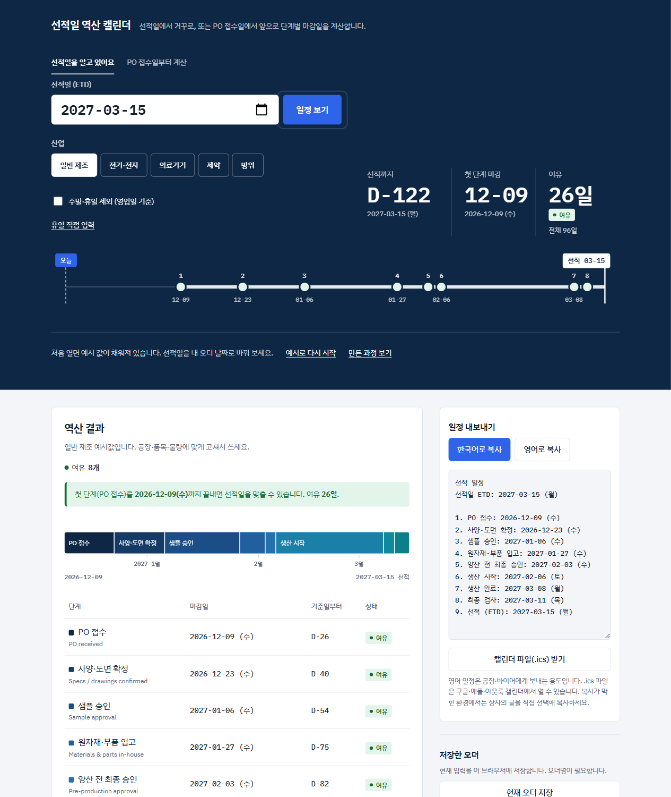

# 선적일 역산 캘린더

해외영업 담당자가 **선적일(ETD)에서 거꾸로** 단계별 마감일을 계산하고, 일정이 모자란 것을 바로 확인하는 도구입니다.
반대로 **PO 접수일에서 앞으로** 계산해 가능한 가장 빠른 선적일과 바이어 요청 선적일과의 차이도 알려 줍니다.

- 배포 주소: https://calculation-choeg6801-eng.vercel.app/
- 소개 페이지: `index.html` · 서비스 시연: `app.html`

## 주요 기능

- 선적일에서 역산: 단계별 마감일, 타임라인, 일정 부족 경고
- PO 접수일에서 순방향 계산: 가능한 가장 빠른 선적일, 바이어 요청 선적일과 비교
- 산업별 예시 단계: 일반 제조 / 전기·전자 / 의료기기 / 제약 / 방위 (인허가·인증 단계는 "기간 변동 큼" 표시)
- 주말 제외, 직접 입력한 휴일 제외
- 단계 이름(한·영)과 기간 직접 수정
- 한국어·영어 일정 텍스트 복사, 캘린더 파일(.ics), 엑셀(CSV)
- 공유 링크(입력한 값을 주소에 담음), 여러 오더 저장

## 사용 방법

별도 설치가 없습니다. `index.html`을 브라우저로 열면 됩니다. 서비스는 `app.html`입니다.

## 만든 방식

- 순수 HTML·CSS·JavaScript (빌드와 서버 없음)
- 입력값은 브라우저 저장소(`localStorage`)에만 저장되고 서버로 보내지 않습니다.
- 글꼴: IBM Plex Sans KR, IBM Plex Mono (Google Fonts)

## 한계

- **산업별 단계 이름과 기간은 예시입니다.** 일반적인 흐름으로 만든 초안이며 실제 규정 문서로 하나씩 대조하지 않았습니다. 실제 인허가·인증·수출허가 기간은 공식 절차와 담당 기관에서 확인해야 합니다.
- 실제 사용자 인터뷰는 아직 하지 않았습니다.
- 단계는 일렬로만 이어지며, 동시에 진행되는 단계는 표현하지 못합니다.
- 공휴일은 자동으로 반영하지 않고 사용자가 직접 입력합니다.
- 저장한 오더 목록은 사용한 브라우저에만 남습니다.

## 이미지

소개 페이지의 컨테이너 사진은 AI로 생성한 이미지입니다.
